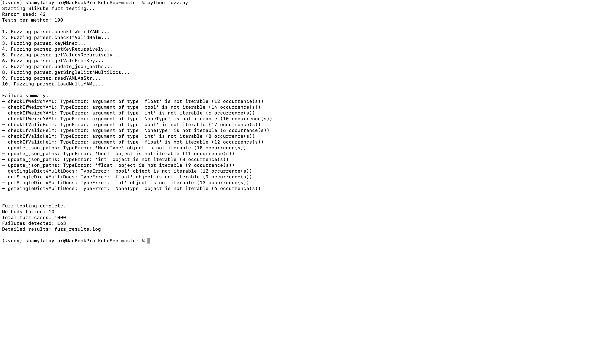
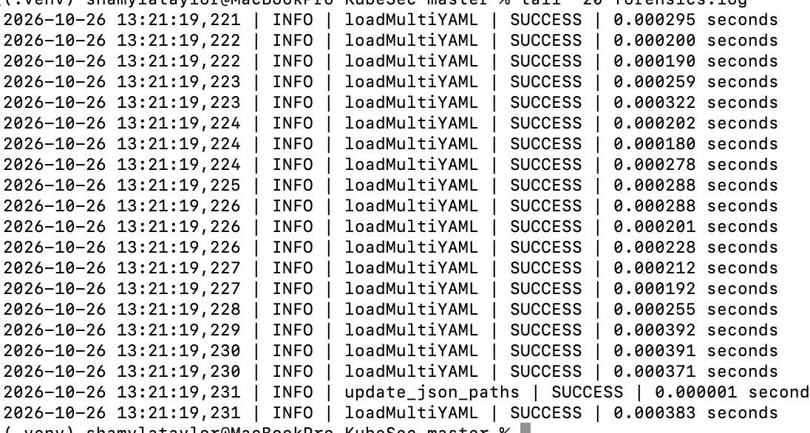
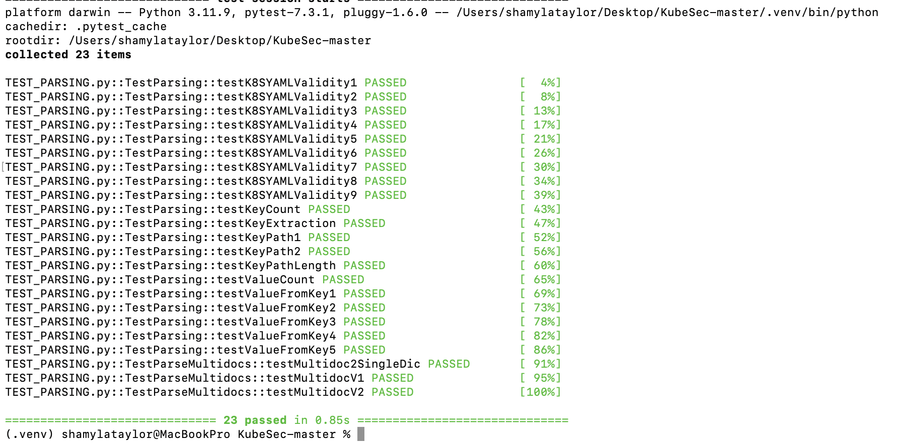
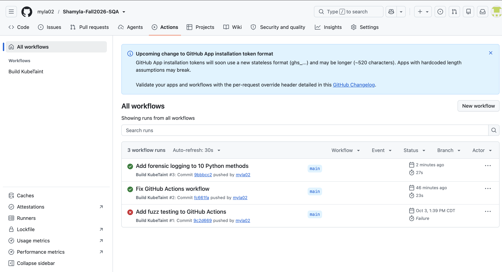

# Software Quality Assurance Project Report

**Student:** Shamyla Taylor  
**Course:** COMP 5710 – Software Quality Assurance  
**GitHub:** https://github.com/myla02/Shamyla-Fall2026-SQA

## Project Overview

For this project, I worked with an existing Python project called Slikube. I added fuzz testing, software forensics, and continuous integration to help find errors and improve testing.

## Fuzz Testing

I created `fuzz.py` to test 10 methods from `parser.py`, running 100 tests on each method.

**Results:**
- 1,000 total tests
- 163 failing test cases
- Results saved in `fuzz_results.log`

I found that methods like `checkIfWeirdYAML`, `checkIfValidHelm`, and `update_json_paths` raised `TypeError` exceptions when given unexpected inputs, such as numbers, Boolean values, and `None`. These were possible input-handling issues rather than confirmed separate bugs.

## Software Forensics

I created `forensics.py` and added logging to 10 methods in `parser.py`. The logger records timestamps, method names, success or error status, and execution time.

I tested both successful and failed executions, and the results were saved in `forensics.log`. All 23 original parser tests still passed after my changes.

## Continuous Integration

I updated GitHub Actions to automatically run the parser tests and `fuzz.py` whenever changes are pushed to the main branch.

The workflow initially failed because of a YAML formatting error. After fixing it, GitHub Actions ran successfully.

## Challenges and Lessons Learned

I had to fix issues with GitHub push protection, GitHub Actions formatting, and verifying forensic logs.

This project helped me understand how fuzz testing finds possible errors, how forensic logging tracks program activity, and how GitHub Actions automatically tests code changes.

## Conclusion

Overall, I completed fuzz testing, forensic logging, and continuous integration. I also learned the importance of testing changes to make sure the original program still works.

## Screenshots and Testing Evidence

**Fuzz Testing**

**Forensic Logging**

**Python Tests**

**GitHub Actions**

